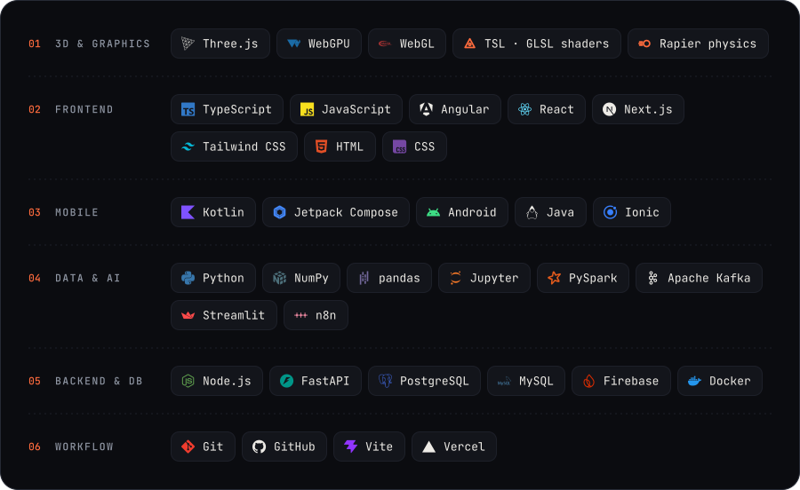
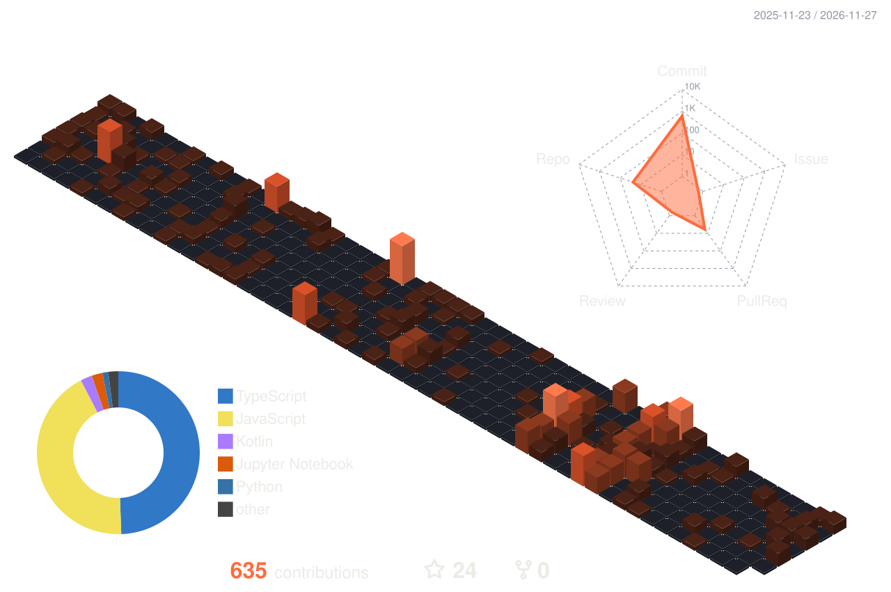
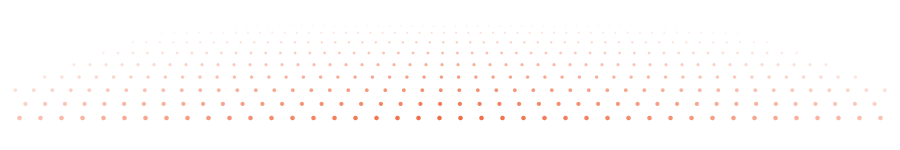

<a href="https://sergii-butrii.com">
  <picture>
    <source media="(prefers-color-scheme: dark)" srcset="https://raw.githubusercontent.com/Sergiibut05/Sergiibut05/main/assets/hero-dark.svg">
    <source media="(prefers-color-scheme: light)" srcset="https://raw.githubusercontent.com/Sergiibut05/Sergiibut05/main/assets/hero-light.svg">
    
  </picture>
</a>

  <a href="https://sergii-butrii.com"><picture><source media="(prefers-color-scheme: dark)" srcset="https://raw.githubusercontent.com/Sergiibut05/Sergiibut05/main/assets/btn-portfolio-dark.svg"><source media="(prefers-color-scheme: light)" srcset="https://raw.githubusercontent.com/Sergiibut05/Sergiibut05/main/assets/btn-portfolio-light.svg"></picture></a>&nbsp;
  <a href="https://www.linkedin.com/in/sergii-butrii-4b0729346/"><picture><source media="(prefers-color-scheme: dark)" srcset="https://raw.githubusercontent.com/Sergiibut05/Sergiibut05/main/assets/btn-linkedin-dark.svg"><source media="(prefers-color-scheme: light)" srcset="https://raw.githubusercontent.com/Sergiibut05/Sergiibut05/main/assets/btn-linkedin-light.svg"></picture></a>&nbsp;
  <a href="mailto:sergiibutrii5@gmail.com"><picture><source media="(prefers-color-scheme: dark)" srcset="https://raw.githubusercontent.com/Sergiibut05/Sergiibut05/main/assets/btn-email-dark.svg"><source media="(prefers-color-scheme: light)" srcset="https://raw.githubusercontent.com/Sergiibut05/Sergiibut05/main/assets/btn-email-light.svg"></picture></a>

 

### About

I'm a software developer based in Málaga who cares about the details people *feel*: smooth interactions, fast load times and interfaces that simply make sense. I also care about the systems underneath that keep them efficient.

I graduated in **Multiplatform Application Development (DAM)**, including dual training at **Aliqindoi**, and I'm now specializing in **Artificial Intelligence & Big Data**.

My interactive 3D portfolio received an **[Awwwards Honorable Mention](https://sergii-butrii.com)**. I built it with **Three.js** and **WebGPU**, chasing the right balance between interactive physics and a smooth frame rate in the browser.

I speak Spanish and Ukrainian natively and English at **C1 (Cambridge CAE, 190)**, so I'm comfortable working in international teams.

 

### What I do

<table>
  <tr>
    <td width="33%" valign="top">
       
      <b>Real-time 3D for the web</b>
      
Three.js, WebGPU, TSL&nbsp;/&nbsp;GLSL shaders and Rapier physics. Rich, interactive scenes that still run smoothly on modest hardware.

    </td>
    <td width="33%" valign="top">
       
      <b>Frontend &amp; mobile</b>
      
Angular and TypeScript on the web, Kotlin with Jetpack Compose on Android. Clean interfaces, careful UX, maintainable code.

    </td>
    <td width="33%" valign="top">
       
      <b>Data &amp; AI</b> (current focus)
      
Python, pandas and PySpark for analysis, Apache Kafka for real-time streams, and LLMs wired into real workflows with n8n and MCP.

    </td>
  </tr>
</table>

 

### Toolbox

<picture>
  <source media="(prefers-color-scheme: dark)" srcset="https://raw.githubusercontent.com/Sergiibut05/Sergiibut05/main/assets/stack-dark.svg">
  <source media="(prefers-color-scheme: light)" srcset="https://raw.githubusercontent.com/Sergiibut05/Sergiibut05/main/assets/stack-light.svg">
  
</picture>

 

### Activity

<picture>
  <source media="(prefers-color-scheme: dark)" srcset="https://raw.githubusercontent.com/Sergiibut05/Sergiibut05/main/profile-3d-contrib/contrib-dark.svg">
  <source media="(prefers-color-scheme: light)" srcset="https://raw.githubusercontent.com/Sergiibut05/Sergiibut05/main/profile-3d-contrib/contrib-light.svg">
  
</picture>

My contribution graph, in 3D, naturally. Rebuilt every night by a GitHub Action.

 

Every graphic on this page is generated from code. See <a href="https://github.com/Sergiibut05/Sergiibut05/tree/main/tools"><code>tools/</code></a>.

